# Finly

[English](README.md) · [Español](README.es.md) · [Català](README.ca.md) · [Galego](README.gl.md) · [Euskara](README.eu.md) · [Français](README.fr.md) · [Deutsch](README.de.md) · [Português](README.pt.md) · [Italiano](README.it.md)

**Finly** és una app de finances personals per controlar ingressos i despeses. Anota el que guanyes i gastes cada dia, organitza-ho en diversos comptes i categories personalitzades, i entén els teus diners amb gràfics, filtres per període, etiquetes i comentaris.

Tot funciona **al dispositiu**: les teves dades viuen en una base de dades SQLite local (sql.js + IndexedDB al web), res no surt del teu telèfon i no cal cap compte ni subscripció.

| | |
|---|---|
| **Plataformes** | iOS, Android i Web |
| **Versió** | 2.2.0 |
| **Idiomes** | Anglès, Castellà, Català, Gallec, Basc, Francès, Alemany, Portuguès i Italià |
| **Dades** | 100 % locals (SQLite al nadiu, sql.js + IndexedDB al web) |
| **Temes** | Fosc, Clar i Automàtic (segueix el sistema) |

## Funcions

- **Diversos comptes** — crea, edita i esborra comptes, cada un amb la seva icona, color i saldo inicial opcional. Un compte especial **Total** ho agrega tot.
- **Control d'ingressos i despeses** — afegeix transaccions en un dia concret amb import, compte, categoria, etiquetes, comentari i una foto opcional.
- **Categories personalitzades** — tria entre una biblioteca d'icones i colors, i crea les teves pròpies categories de despeses i ingressos.
- **Gràfics** — gràfic de dònut amb el total al centre i gràfic de barres apilades horitzontal, amb un desglossament per categories que mostra percentatges.
- **Filtres per període** — Dia, Setmana, Mes, Any i rangs personalitzats amb selector de calendari.
- **Totes les transaccions** — filtres combinats: tipus, categories (multiselecció), període, compte, etiquetes i cerca amb ordenació per data o import.
- **Etiquetes i comentaris** — etiqueta transaccions i filtra per etiqueta; gestiona tots els comentaris de l'app i aplica edicions o esborrats massius a diverses transaccions alhora.
- **Fotos** — adjunta una foto a una transacció des de la galeria en totes les plataformes (càmera a iOS i Android).
- **Regles recurrents** — converteix una transacció en una programació que es repeteix (diària, setmanal, mensual o anual, amb interval i data de fi opcional); les ocurrències vençudes es generen soles i cada regla es pot pausar, reprendre o editar aplicant el canvi només al futur o també al passat.
- **Accions massives** — multiselecciona i esborra transaccions, etiquetes, comentaris i categories d'una vegada.
- **Còpia de seguretat** — exporta tota la base de dades com a instantània JSON i importa-la quan vulguis.
- **Configuració** — tema, mida del text, moneda, separador decimal, idioma, primer dia de la setmana, formes d'icones, valors per defecte d'inici i d'afegir transacció, i opcions de privadesa per ocultar saldos.
- **Calculadora integrada** — una petita calculadora a la pantalla d'afegir transacció per calcular imports.

## Captures de pantalla

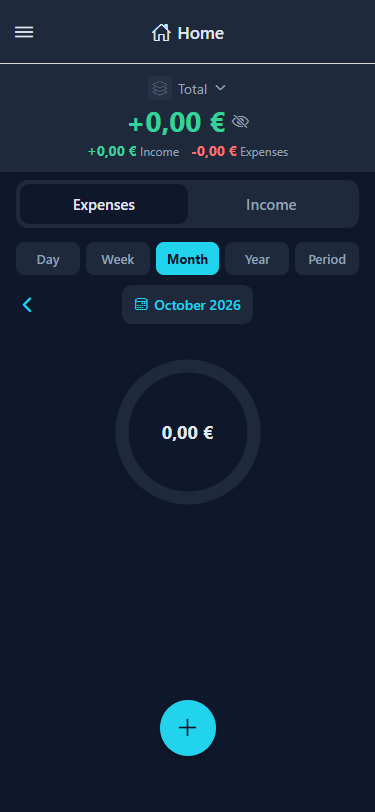<br>*Instal·lació nova sense transaccions.*<br><br>
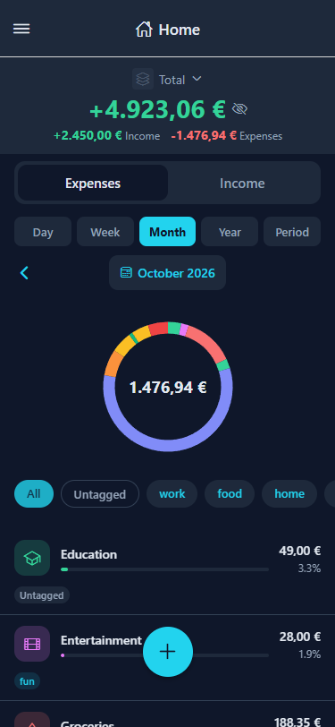<br>*Pantalla d'inici amb comptes, gràfic de dònut i desglossament per categories.*<br><br>
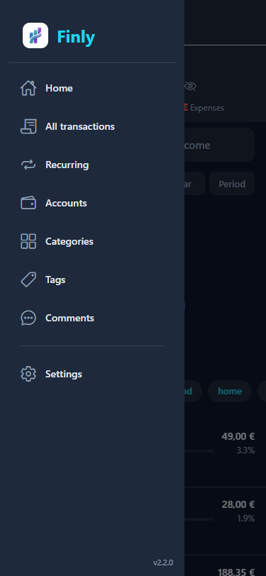<br>*Menú lateral amb Inici, Totes les transaccions, Recurrents, Comptes, Categories, Etiquetes, Comentaris i Ajustos.*<br><br>
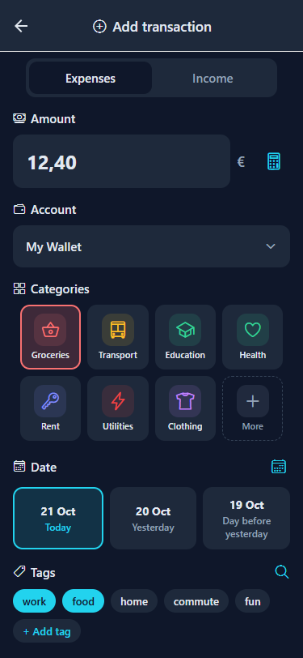<br>*Afegeix una despesa o ingrés amb import, compte, categoria, dia, etiquetes, comentari i foto.*<br><br>
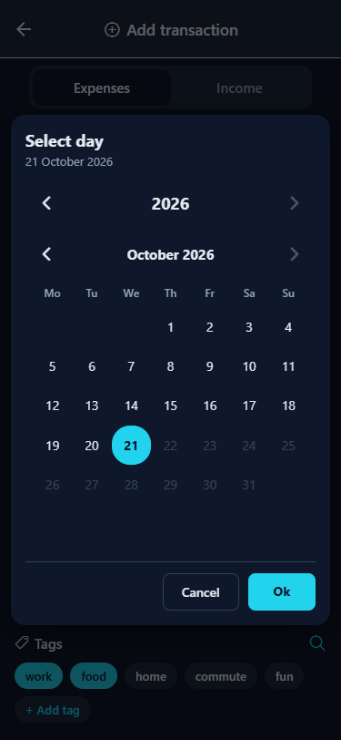<br>*Selector de calendari per triar un dia, setmana, mes, any o rang de període personalitzat.*<br><br>
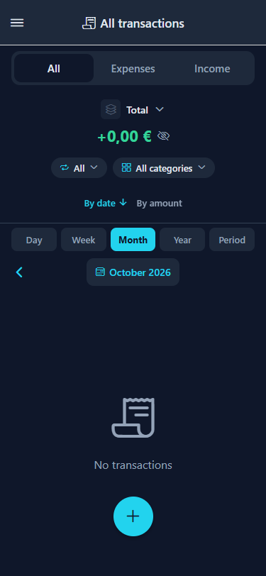<br>*Totes les transaccions en estat buit.*<br><br>
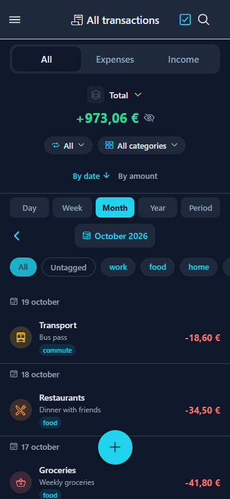<br>*Totes les transaccions amb filtres de tipus, categoria, període i etiquetes, a més d'ordenació i cerca.*<br><br>
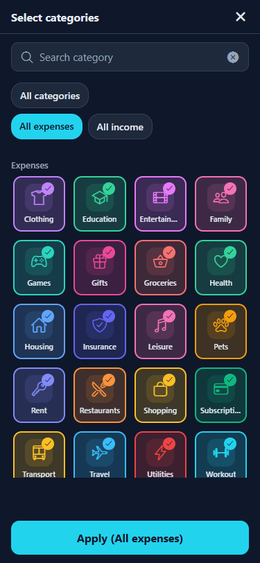<br>*Filtre de categories amb els predefinits Totes les categories, Totes les despeses i Tots els ingressos.*<br><br>
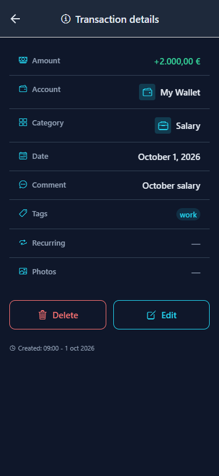<br>*Detalls d'una transacció d'ingrés amb edició i eliminació.*<br><br>
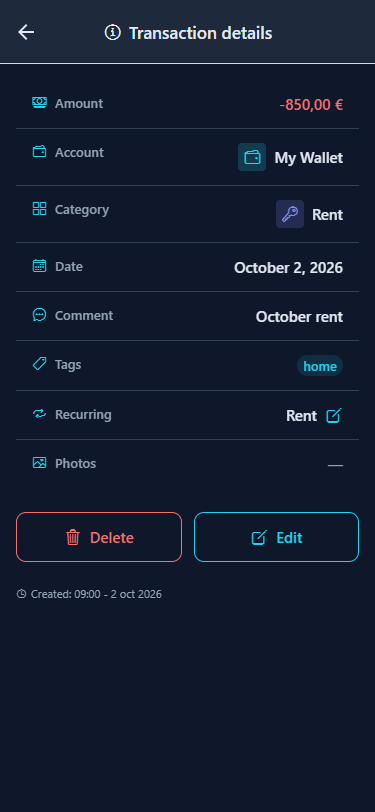<br>*Detalls d'una transacció de despesa amb edició i eliminació.*<br><br>
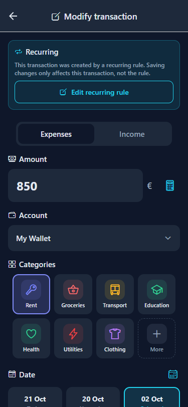<br>*Edita l'import, el compte, la categoria, el dia, les etiquetes, el comentari i la foto d'una transacció.*<br><br>
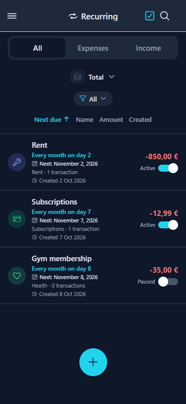<br>*Regles recurrents amb properes dates, imports i interruptors d'activa/pausada.*<br><br>
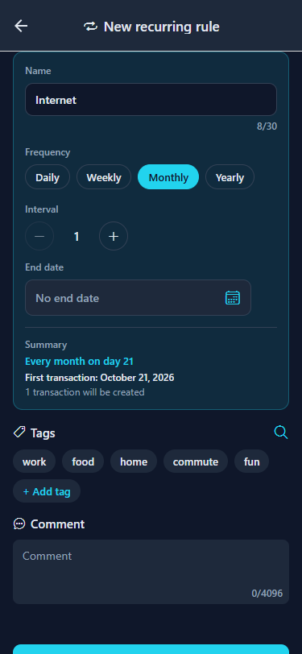<br>*Configura una regla recurrent amb el nom, la freqüència, l'interval i una data de final opcional.*<br><br>
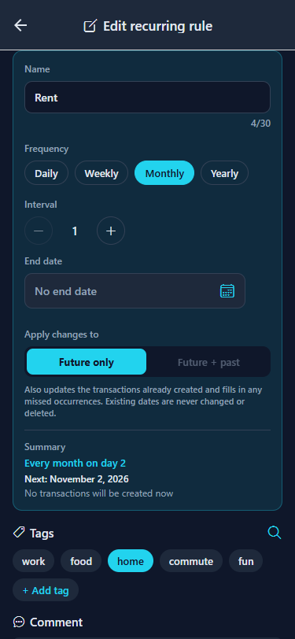<br>*Edita la programació d'una regla recurrent i tria si el canvi s'aplica només a les properes repeticions o també a les passades.*<br><br>
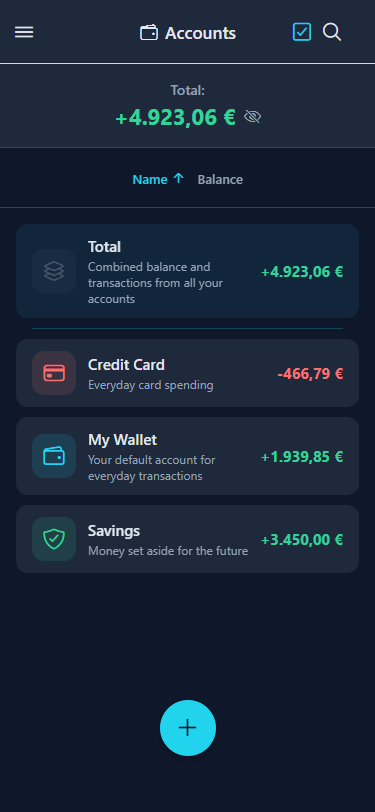<br>*Pantalla de comptes amb saldos i el compte Total agregat.*<br><br>
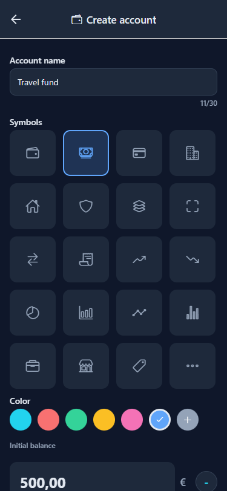<br>*Crea un compte amb nom, icona, color, saldo inicial i nota opcional.*<br><br>
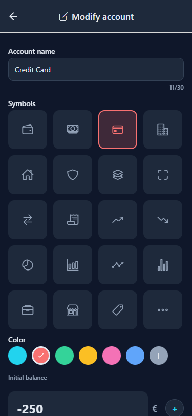<br>*Edita les dades, el saldo inicial i la nota d'un compte, o elimina'l.*<br><br>
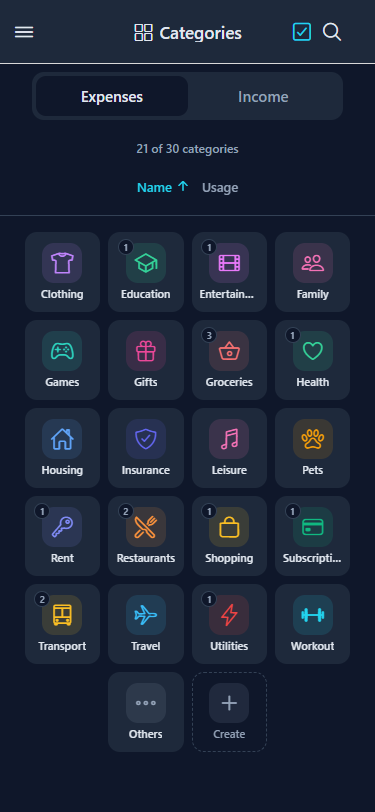<br>*Categories organitzades per tipus (despeses/ingressos) en una graella de 4×N.*<br><br>
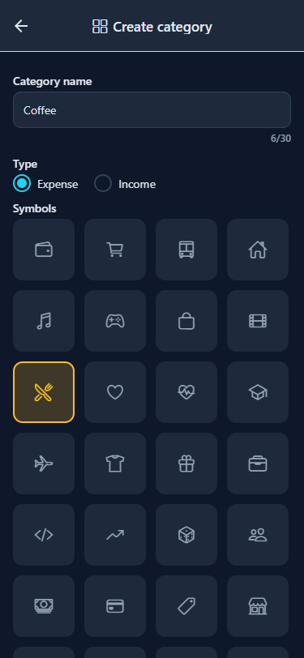<br>*Crea una categoria de despesa o ingrés amb nom, icona i color.*<br><br>
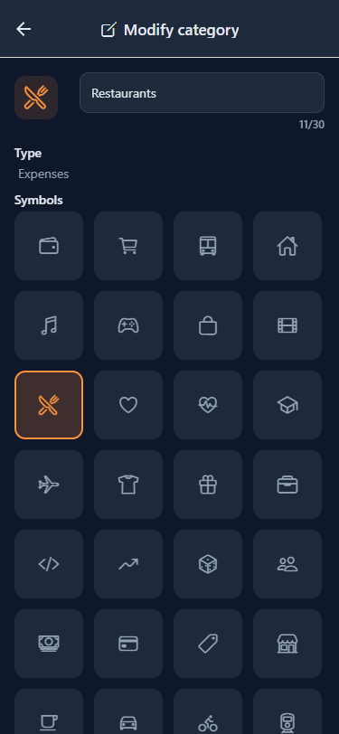<br>*Edita el nom, la icona i el color d'una categoria, o elimina-la.*<br><br>
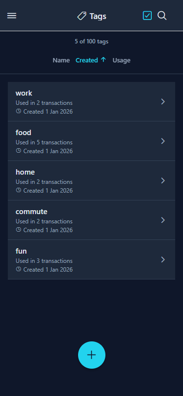<br>*Pantalla d'etiquetes amb cerca i selecció massiva.*<br><br>
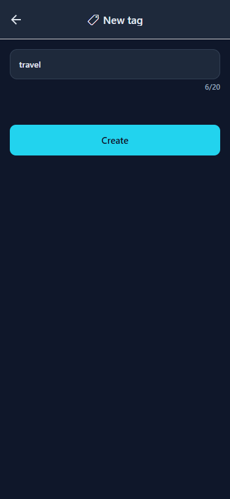<br>*Crea una etiqueta per agrupar transaccions.*<br><br>
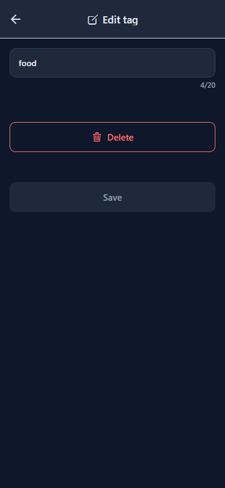<br>*Canvia el nom o elimina una etiqueta.*<br><br>
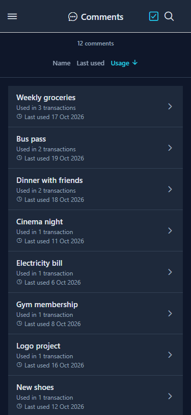<br>*Pantalla de comentaris amb cerca, recompte d'ús i selecció múltiple.*<br><br>
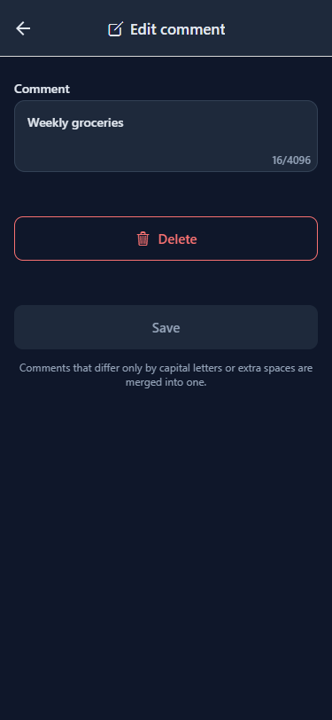<br>*Edita un comentari a totes les transaccions que l'utilitzen.*<br><br>
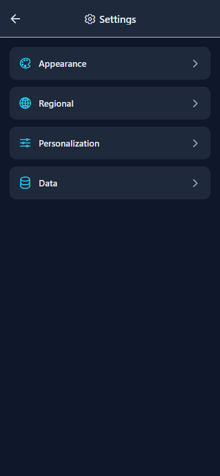<br>*Configuració: Aparença, Regional, Personalització i Dades.*<br><br>
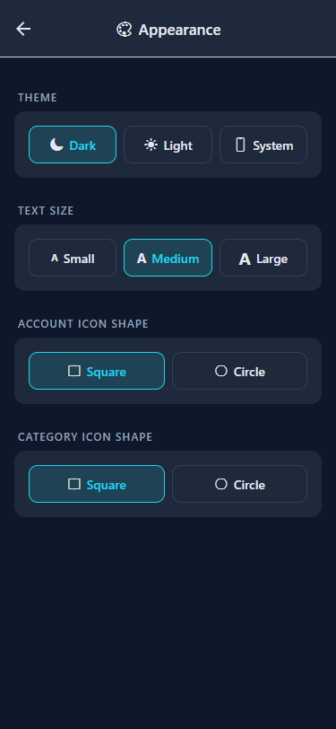<br>*Aparença: tema, mida del text i formes d'icones.*<br><br>
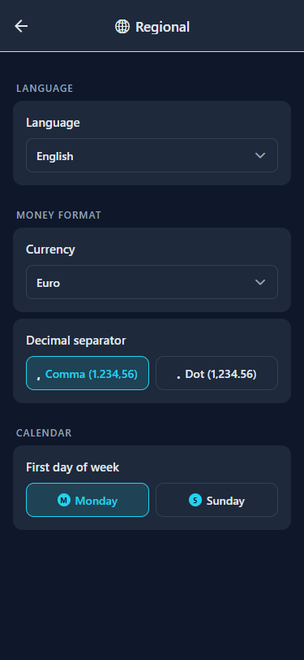<br>*Configuració regional: idioma, moneda, separador decimal i primer dia de la setmana.*<br><br>
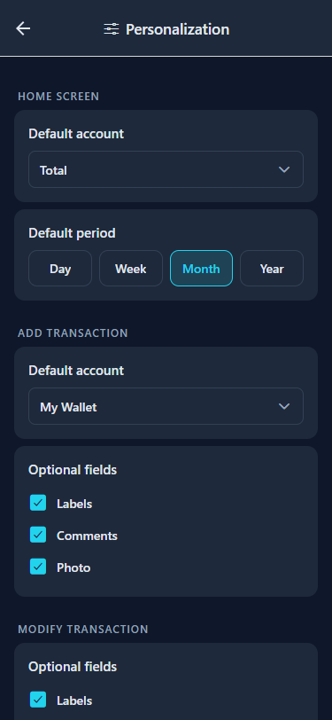<br>*Personalització: valors per defecte d'inici i d'afegir transacció, i privadesa.*<br><br>
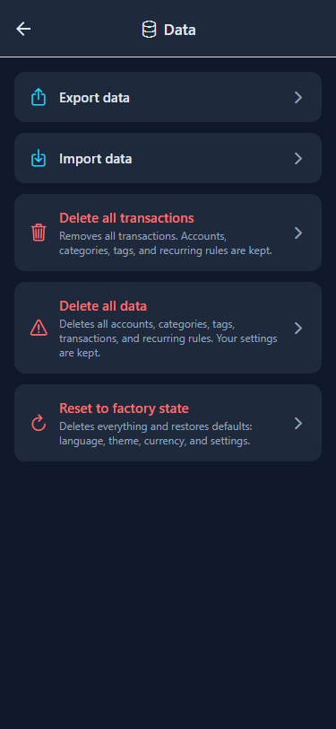<br>*Dades: exportació/importació de còpia de seguretat i accions d'esborrat/reinici.*<br><br>

## Stack tecnològic

| Capa | Tecnologia |
|---|---|
| Framework | React Native amb Expo (SDK 57) |
| Llenguatge | TypeScript |
| Navegació | React Navigation (Stack + Drawer) |
| Icones | @expo/vector-icons (Ionicons) |
| Gràfics | react-native-svg |
| Selector de color | reanimated-color-picker |
| Persistència | SQLite (expo-sqlite) al nadiu, sql.js (WASM) + IndexedDB al web |
| ORM | Drizzle ORM (sqlite-proxy sobre un DatabaseHandle compartit) |
| Validació | Esquemes Zod com a única font de veritat per a les files emmagatzemades |
| Web | react-native-web |
| Estat | Context API (AppContext + ConfigContext) |
| i18n | Sistema propi (en, es, ca, gl, eu, fr, de, pt, it) |

## Desenvolupament

Aquesta secció és per a les persones que hi contribueixen i per a qualsevol que vulgui executar, fer un fork o ampliar l'app.

### Requisits

- Node.js 20+ (es recomana Node 24)
- npm
- Un emulador d'Android opcional (la carpeta `android/` la genera CNG — vegeu més avall)

### Primera vegada després de clonar

```bash
cd FinlyApp
npm install
npx expo start
```

Això inicia Metro Bundler. Després:

| Per veure en… | Fes això |
|---|---|
| **Navegador** | Obre http://localhost:8081 o executa `npx expo start --web` |
| **Android (emulador)** | Executa `npx expo run:android` |
| **iOS (simulador)** | Executa `npx expo run:ios` (només macOS) |

### Comandes

| Comanda | Descripció |
|---|---|
| `npm start` | Inicia Expo en mode desenvolupament |
| `npm run web` | Inicia i obre al navegador |
| `npm run android` | Inicia a l'emulador d'Android |
| `npm run ios` | Inicia al simulador d'iOS (només macOS) |
| `npm run typecheck` | Comprovació de TypeScript (`tsc --noEmit`) |
| `npm run lint` | ESLint mitjançant `expo lint` |
| `npm test` | Executa la suite de Vitest |
| `npm run test:watch` | Executa Vitest en mode watch |
| `npm run test:all` | typecheck + lint + tests (la verificació local completa) |
| `npm run lint:fix` | Corregeix automàticament els problemes de lint/format (sagnat, cometes, comes finals, salt de línia final) |
| `npm run i18n` | Afegeix, actualitza, elimina o llista claus de traducció als 9 idiomes |

### Proves

- **Unitàries / integració** — Vitest. La suite cobreix els repositoris de base de dades en tots dos backends SQLite (nadiu + sql.js), els round-trips de còpia de seguretat i els components renderitzats amb `@testing-library/react-native`.
- **E2E natives** — els fluxos de Maestro a `FinlyApp/.maestro/` (15 fluxos + helpers) s'executen contra l'APK de depuració en un emulador d'Android; vegeu `docs/harnesses.md`.
- **Verificació web** — els criteris d'acceptació de cada funció es verifiquen en un navegador real a 375px amb Playwright.
- El pipeline de CI (`.github/workflows/ci.yml`) executa el gate complet `npm run test:all` en cada push i pull request de `develop` i `main`.

> **Gate local:** un canvi només està fet quan `npm run test:all` passa.

### Estructura del projecte

```
FinlyApp/
  src/
    components/    — components de UI reutilitzables
    constants/     — temes, tipus, colors, icones
    context/       — AppContext, ConfigContext (estat global)
    database/      — motors SQLite/sql.js, repositoris, migracions, esquema Drizzle
    hooks/         — hooks personalitzats
    i18n/          — traduccions (en, es, ca, gl, eu, fr, de, pt, it)
    navigation/    — AppNavigator (Drawer + Stack)
    screens/       — components de pantalla (PascalCase)
    utils/         — formatadors, calculadora, plataforma, idioma
  .maestro/        — fluxos i helpers E2E natius
```

### Base de dades

- Una única interfície de motor (`DatabaseHandle`) en totes les plataformes: expo-sqlite al nadiu, sql.js (WASM) amb persistència a IndexedDB al web.
- Les migracions es versionen amb `PRAGMA user_version` (`001_initial`, `002_seed`, `003_config`, `004_recurring`) i s'apliquen una sola vegada, dins d'una transacció.
- Els repositoris estan escrits amb Drizzle ORM sobre el maneig compartit; les files emmagatzemades es validen amb esquemes Zod.
- Al web, els bytes SQLite exportats es persisteixen a IndexedDB, així que les mateixes dades sobreviuen a les recàrregues.

### Generar un APK / AAB d'Android (EAS Build)

Requereix un compte d'Expo i el CLI d'EAS:

```bash
npm install -g eas-cli
eas login
cd FinlyApp
```

| Perfil | Comanda | Resultat |
|---|---|---|
| Development | `eas build --profile development` | build de dev-client (intern) |
| Preview | `eas build --platform android --profile preview` | APK instal·lable (intern) |
| Production | `eas build --platform android --profile production --no-wait` | AAB publicable (botiga) |

El perfil `production` d'`eas.json` utilitza `"distribution": "store"` i `"buildType": "app-bundle"`, produint un AAB per enviar-lo a la botiga. Tingues en compte que la carpeta nativa `android/` la genera Expo CNG (`expo prebuild`); normalment no cal confirmar-la al repositori.

### Metodologia

Aquest projecte utilitza **Desenvolupament guiat per especificacions (SDD).** Les especificacions viuen a `spec/` i són l'única font de veritat — primer es defineix què cal construir en els documents `1-spec.md`, després s'implementa i finalment es verifica contra els criteris d'acceptació. La fulla de ruta es segueix a `spec/constitution/3-roadmap.md`.

## Llicència

Finly està sota la llicència MIT — consulta el fitxer [LICENSE](LICENSE).